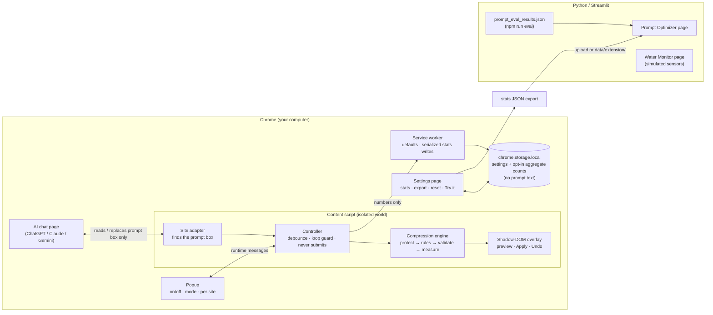
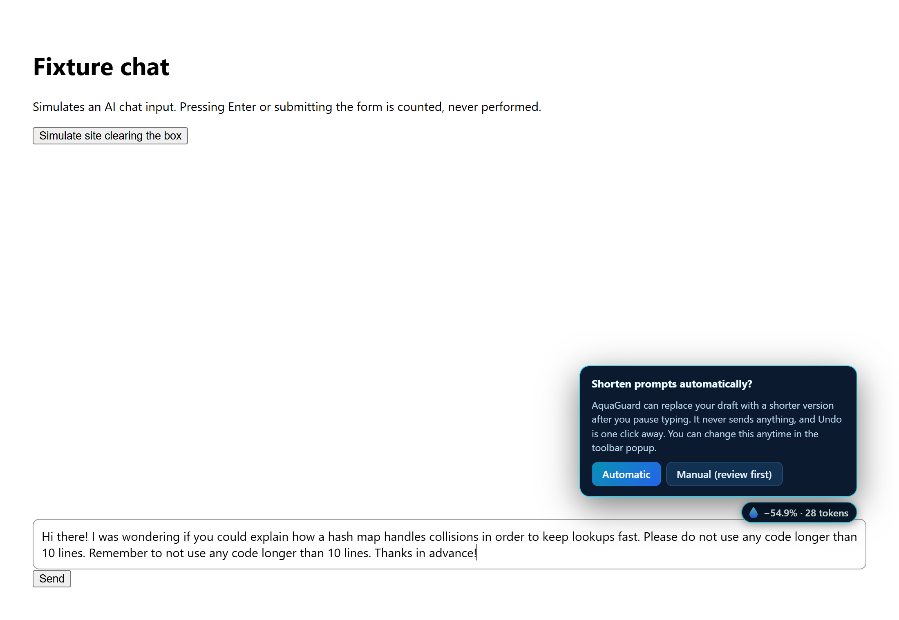
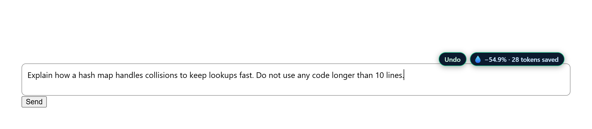
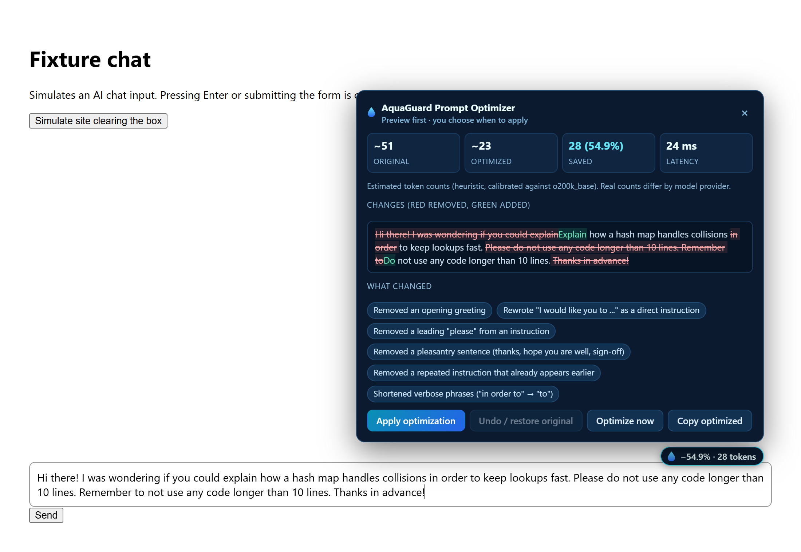
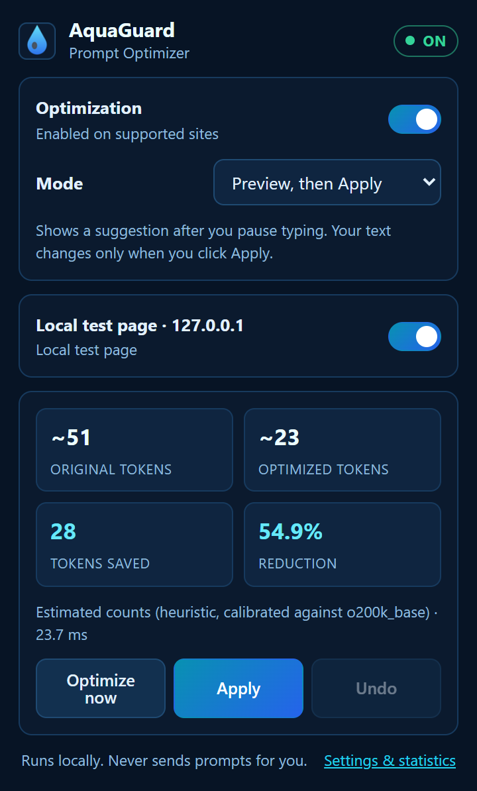
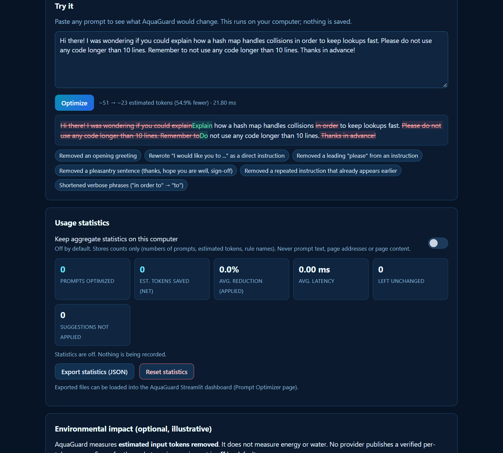

# 💧 AquaGuard

AquaGuard has two parts that share one goal: making the water and energy cost of AI more visible and a little smaller.

1. **AquaGuard Prompt Optimizer**: a Chrome extension (Manifest V3) that shortens verbose AI prompts **in your browser, before you send them**. It works preview-first, every change can be undone, and it never sends a prompt for you.
2. **AquaGuard Water Monitor**: a Python/Streamlit dashboard that detects anomalous cooling-water use in a **simulated** data-center sensor dataset, now with an extra page for extension analytics.

> **Data honesty at a glance**
>
> | What you see | What it is |
> |---|---|
> | Sensor readings, anomalies, excess litres (main dashboard page) | **Simulated**: generated by `src/generate_data.py` with a fixed random seed |
> | Tokens saved in the extension | **Observed in your text, counted with an estimate** (local heuristic tokenizer, not the provider's) |
> | Evaluation results | **Measured** on 45 synthetic test prompts, using exact `o200k_base` token counts plus automated meaning checks |
> | Energy / water saved by shorter prompts | **Not measured.** Off by default; optional *illustrative* scenario from your own assumptions |
>
> Nothing in this project is a verified measurement of water saved.

---

## Contents

- [The problem](#the-problem)
- [How prompt compression helps (and its limits)](#how-prompt-compression-helps-and-its-limits)
- [Architecture](#architecture)
- [Features](#features)
- [Install the extension (developer mode)](#install-the-extension-developer-mode)
- [Using the extension](#using-the-extension)
- [Run the Streamlit dashboard](#run-the-streamlit-dashboard)
- [Run the tests](#run-the-tests)
- [Privacy and permissions](#privacy-and-permissions)
- [Evaluation methodology and results](#evaluation-methodology-and-results)
- [Limitations and environmental assumptions](#limitations-and-environmental-assumptions)
- [Packaging for the Chrome Web Store](#packaging-for-the-chrome-web-store)
- [Screenshots](#screenshots)
- [Project layout](#project-layout)
- [Roadmap](#roadmap)

---

## The problem

Data centers that serve AI models use electricity, and many also use water: directly for evaporative cooling, and indirectly through the power plants that generate their electricity. Every prompt adds a little load. A lot of prompt text is social or redundant: "Hi there! Could you please…", "Thanks in advance!", or the same instruction repeated twice. A language model has to process those tokens anyway.

AquaGuard Prompt Optimizer removes that kind of text **on your computer**, shows you exactly what it would change, and lets you decide.

## How prompt compression helps (and its limits)

The chain of cause and effect, with an honest note on each link:

```
fewer input tokens ──► less prefill compute ──► (maybe) less energy ──► (maybe) less water
     observed             depends on model,         depends on hardware,      depends on cooling
  (estimated count)       serving stack, batching    utilization, idle power   design, climate, grid
```

- **Tokens → compute.** A model reads (prefills) every input token. Fewer input tokens means less of that work. This link is solid.
- **Compute → energy.** Real but not linear. It depends on the model, the hardware, batching, caching and idle power. Reading input tokens is also much cheaper per token than generating output tokens, and shortening a prompt does not shorten the answer.
- **Energy → water.** Depends on the data center's cooling (evaporative vs. dry) and climate (on-site water use), and on the electricity mix (off-site water). Providers publish few figures, and none per input token for these chat services.

So AquaGuard **reports the first link it can observe (tokens removed from your text)** and leaves energy and water as *unavailable* unless you enter your own assumptions. It **never invents a litres-per-token number.**

**Fewer tokens do not automatically mean an equally good answer.** The compressor is built to keep meaning (see [Evaluation](#evaluation-methodology-and-results)), but semantic equivalence of model outputs has not been tested.

## Architecture



**Compression engine** (`extension/src/engine/`) is plain JavaScript that runs identically in Chrome and in Node tests:

| Module | Job |
|---|---|
| `compressor.js` | Pipeline: protect code/URLs/quotes/paths/tables/payloads → collapse whitespace → sentence rules → de-duplicate → phrase rules → restore → **global validation** → token measurement. Defines the `Compressor` interface for future semantic or LLM compressors. |
| `rules.js` | Reviewed rules: greetings, pleasantries, "Could you please…" preambles, verbose phrases ("in order to" → "to"), repeated instructions, doubled words. No synonym swapping of technical words. |
| `features.js` | The meaning guard. Every rewrite is checked: numbers, negations, constraint words (*must, only, never, at least…*), protected spans and all other words must survive unless the rule is explicitly allowed to change them. |
| `tokenizer.js` | Tokenizer abstraction plus a calibrated heuristic (labelled **estimate**). |
| `diff.js` | Word-level diff for the preview. |
| `impact.js` | Transparent, assumption-driven impact estimate; unavailable by default. |

## Features

- **One-time choice.** The first time AquaGuard finds a shorter version, a small card asks **Automatic** or **Manual**. Your answer is saved in Chrome storage and never asked again unless you reset it.
- **Automatic mode.** After you pause typing (default 1 s), your draft is replaced with the shorter version. A compact indicator shows `−35% · 78 tokens saved` next to a one-click **Undo** that restores your exact original. There's no popup, no diff panel, and no Apply click.
- **Manual mode.** A pill shows the saving. Click it for a red/green diff, token estimates, latency and a plain-language list of what changed, then **Apply** when you want.
- **Apply / Undo / Optimize now / Copy optimized** in the page overlay and in the toolbar popup. The popup can also open the detailed comparison on the page.
- **Modes:** *Automatic*, *Manual: preview, then Apply*, and *Preview only* (never touches your text).
- **Never sends.** No Enter key events and no clicks on the site's send button. Covered by automated tests.
- **Safe editing.** No optimization while you type or during IME composition, and none on text the extension just wrote itself (no input loops). Changes made by the site (for example the box being cleared after sending) are detected. Writes go through the browser's editing pipeline, so React, ProseMirror and Quill editors stay in sync.
- **Multi-pass, context-aware compression** (default *Balanced* level; *Conservative* uses fewer rule types). Rules shorten requests that follow a lead-in ("After that, could you also…" → "After that, provide…"), drop additive transitions ("Also,") and redundant intros ("Keep in mind that"), remove reworded repeats of a requirement only when they say exactly the same thing, and remove a re-stated description of yourself only when the prompt already states it. Order words ("First", "Then", "Finally") are never removed.
- **Keeps the original** when no safe, shorter rewrite exists, and says why ("Already concise", "Validation failed", …).
- **Per-site disable**, global on/off, configurable delay and minimum prompt length.
- **Opt-in aggregate statistics** (counts only), JSON export, one-click reset.
- **"Try it" sandbox** on the settings page, so you can use the optimizer with any site by copy and paste.

### Supported sites

| Site | Status | Editor | Notes |
|---|---|---|---|
| chatgpt.com | **Primary** | React textarea / ProseMirror | Logged-out composer selector and write path checked against the live site on 2026-10-17. The signed-in composer could not be checked (no account was used). |
| claude.ai | Experimental | ProseMirror | Selectors based on the editor framework. Not checked live (requires sign-in). |
| gemini.google.com | Experimental | Quill | Selector matched the live logged-out composer on 2026-10-17. |

Chat sites change their markup often, so an adapter can break without warning. Each site is one entry in `extension/src/content/adapters.js` plus one URL pattern in `manifest.json`. The editor engines themselves (ProseMirror, Quill, textarea, contenteditable) are covered by automated browser tests on local fixture pages.

## Install the extension (developer mode)

1. Get the code: `git clone https://github.com/keithdias07/aquaguard-data-center-water-monitor.git`
2. Open `chrome://extensions` in Chrome (or another Chromium browser, version 116 or newer).
3. Turn on **Developer mode** (top-right switch).
4. Click **Load unpacked** and select the **`extension/`** folder.
5. Pin the 💧 AquaGuard icon from the puzzle-piece menu.
6. Open chatgpt.com (or reload it if it was already open) and start typing.

No build step is needed. The extension is plain JavaScript, HTML and CSS.

To install the packaged ZIP instead, build it (see [Packaging](#packaging-for-the-chrome-web-store)), unzip it into a folder, and load that folder.

## Using the extension

**First prompt:** type a prompt of 40+ characters on a supported site and pause. If a shorter version exists, a small card asks *"Shorten prompts automatically?"*
- **Automatic:** your current draft is shortened right away, and future drafts are shortened after each typing pause.
- **Manual:** you keep the review-and-Apply workflow.

You can also answer this from the toolbar popup.

**Automatic mode.** Type normally and pause. When the saving is worth it, your draft is replaced and the indicator shows the tokens saved. Click **Undo** to restore the exact original; after an Undo, that draft is left alone. **Nothing is ever sent.** You read the result and press send yourself.

AquaGuard deliberately does *not* replace your text, and leaves the suggestion in the pill for a manual Apply, when:
- you're still typing, or an IME composition (e.g. Japanese, Chinese) is active;
- your cursor is in the middle of the text, or text is selected;
- the saving is below the threshold (default: at least 3 tokens and 3%);
- the prompt box isn't focused;
- the site's editor rejected an earlier automatic change. Your text is kept, the site switches to preview mode, and the popup offers **Retry**.

**Manual mode.** Click the pill to review the diff, then **Apply optimization**. **Undo / restore original** (or Ctrl+Z in the box) reverts it.

**Change your mind:**
- Toolbar popup → **Mode** (Automatic / Manual / Preview only), or switch AquaGuard off everywhere or on the current site.
- Settings → **Ask me again** resets the one-time choice.
- Settings → **Reset all settings and data** clears everything.

**Settings & statistics** has every option (delay, minimum length, automatic-mode thresholds, compression level), the Try-it sandbox, opt-in statistics, export and reset.

## Run the Streamlit dashboard

```bash
python -m venv .venv
```

Activate it (Windows PowerShell: `.venv\Scripts\Activate.ps1`; macOS/Linux: `source .venv/bin/activate`), then:

```bash
pip install -r requirements.txt
```

```bash
streamlit run app.py
```

Run the command from the repository root. The dashboard reads `data/*.csv` relative to it. Open the **Prompt Optimizer** page in the sidebar for extension analytics. It shows clearly labelled **synthetic sample** statistics until you upload your own export (Settings → *Export statistics*), or save the export as `data/extension/extension_stats.json` (git-ignored).

To regenerate the simulated water data (optional, deterministic):

```bash
python src/generate_data.py && python src/anomaly_detection.py && python src/calculate_wastage.py && python src/recommendations.py
```

## Run the tests

Python (dashboard and analytics):

```bash
pip install -r requirements-dev.txt
```

```bash
python -m pytest tests
```

Extension (from `extension/`, needs Node 20+):

```bash
npm install
```

```bash
npm test
```

```bash
npm run eval
```

```bash
npm run test:e2e
```

- `npm test`: unit tests for the compressor, tokenizer, diff, impact, settings, stats and manifest.
- `npm run eval`: evaluation on the prompt dataset; writes `extension/eval/results/` and `data/extension/prompt_eval_results.json`.
- `npm run test:e2e`: real Chrome with the extension loaded, on local fixture pages with a textarea, a contenteditable, **ProseMirror** and **Quill**. Uses your installed Chrome (set `CHROME_PATH` to override, `HEADFUL=1` to watch). The packaged-ZIP test runs after `python scripts/package_extension.py`.
- `npm run screenshots`: regenerates `docs/screenshots/`.

GitHub Actions ([`.github/workflows/ci.yml`](.github/workflows/ci.yml)) runs all of the above on every push to `main` and every pull request: pytest, unit tests, the evaluation, ZIP build and verification, and the Chrome end-to-end tests. The built ZIP is attached to each run as a downloadable artifact.

## Privacy and permissions

- **Local processing by default (and only).** Prompts are optimized inside your browser. The extension contains no network code. The browser tests check that no request leaves the local fixture server.
- **Only the prompt box, only on listed sites.** No browsing history and no other page content. Content scripts run only on the four sites in the manifest.
- **No prompt storage.** The original text is kept in memory for Undo and is gone when the tab closes.
- **Statistics are opt-in** and contain only counts, estimated token numbers and rule names. They never contain prompt text, page addresses or page content. Tests check this.
- **Reset** statistics or everything from the settings page at any time.

| Permission | Why |
|---|---|
| `storage` | Save your settings (and statistics, if you turn them on) in `chrome.storage.local` |
| Site access: chatgpt.com, chat.openai.com, claude.ai, gemini.google.com (content-script matches) | Read the prompt box and, when you click Apply, replace its text |

No `tabs`, `history`, `scripting`, `<all_urls>` or remote-code permissions are requested. The site you type into still receives whatever you send; AquaGuard does not change that. See [docs/PRIVACY.md](docs/PRIVACY.md).

## Evaluation methodology and results

Full details: [docs/EVALUATION.md](docs/EVALUATION.md). In short, `npm run eval` runs 52 hand-written synthetic prompts in 10 categories (simple questions, coding, long technical prompts, multi-step instructions, numbers and units, constraints and negations, structured JSON/Markdown output, verbose prompts, a long regression prompt, and **prompts that must not be compressed**) and measures:

| Check | Balanced level (default) |
|---|---|
| Correct compress / don't-compress decision | 100% (52/52) |
| Required phrases preserved (`mustPreserve`) | 100% |
| Every number, negation and constraint term preserved | 100% |
| Should-not-compress prompts that were changed | 0 of 17 |
| Token reduction, compressed prompts only (mean, exact `o200k_base`) | 23.1% |
| Total token reduction over the whole dataset (exact `o200k_base`) | 19.1% |
| Median compression latency | ≈0.3 ms |
| Heuristic tokenizer vs `o200k_base` | 3.8% mean absolute error |

**Your original test prompt** (`extension/eval/regression/ml_learning_prompt_original.txt`), a dense, mostly polite-free request (simple explanation, three examples incl. healthcare and cybersecurity, five numbered Python steps, no advanced equations, no assumed neural-network knowledge, under 500 words, a small Python example at the end, exam-friendly):

| | Original | Optimized | Saved | Reduction |
|---|---|---|---|---|
| Estimated tokens, v0.1 | 239 | 228 | 11 | 4.6% |
| **Estimated tokens, now** | **239** | **177** | **62** | **25.9%** |
| Exact `o200k_base` tokens | 226 | 167 | 59 | 26.1% |

All 13 requirements are checked by a unit test and survive. Most of the saving comes from the closing recap ("As I mentioned earlier, I want … so please make sure that all of these requirements are included"). It is removed because you mark it as a repeat and 87.5% of its key words already appear earlier; a recap that adds anything new, or contains a number or negation, is kept.

**Reconstructed regression prompt** (`extension/eval/regression/ml_learning_prompt.txt`), written from the same requirements before the original was available, in a chattier style: a long, polite request for a beginner ML explanation with exactly three examples (incl. healthcare and cybersecurity), exactly five numbered Python steps, no advanced equations, ≤500 words, a small Python example at the end, and beginner-friendly language for a second-year computer engineering student.

| | Original | Optimized | Saved | Reduction |
|---|---|---|---|---|
| Estimated tokens (heuristic) | 232 | 152 | 80 | 34.5% |
| Exact `o200k_base` tokens | 222 | 144 | 78 | 35.1% |

All 10 requirements are checked by a unit test and survive. Latency is about 3 ms (median); the first call in a fresh page is about 40 ms while the JavaScript engine warms up.

**Read these numbers carefully:**

- The dataset was used **while developing the rules**, so it is not a held-out test. The scores are optimistic.
- The checks are **automated proxies** for meaning preservation (protected phrases and terms survive). They are **not** a test of whether a model gives an equally good answer. `extension/eval/results/eval_report.md` has a side-by-side sheet for human review.
- Real prompts are often already concise. Many will be left unchanged, which is the intended behaviour.

## Limitations and environmental assumptions

- **Token counts are estimates.** Claude, Gemini and GPT models use different tokenizers. The heuristic is calibrated against `o200k_base` (about 4% error on prose, about 9% on code) and undercounts rare long words.
- **AquaGuard cannot see what you finally send.** "Tokens saved" is measured at the moment you click Apply.
- **Input tokens only.** Shortening a prompt does not shorten the answer, and output tokens usually dominate generation cost.
- **Environmental impact is unavailable by default.** In illustrative mode you supply low/high Wh per 1,000 input tokens and litres per kWh. The settings page and dashboard show background sources for context (Shehabi et al., LBNL 2016: roughly 1.8 L/kWh on-site water for US data centers; Google 2025: median Gemini Apps text prompt about 0.24 Wh and 0.26 mL, *per whole prompt*), but **neither is a per-input-token factor**. See [docs/ENVIRONMENTAL_METHODOLOGY.md](docs/ENVIRONMENTAL_METHODOLOGY.md).
- **The water dashboard data is simulated** and is never presented as savings from the extension.
- **Rule-based, English-focused.** Other languages are left alone (no rule matches). Text the user wants transformed after a colon ("Proofread: …") is protected, but payloads introduced without a colon may still be compressed.
- **Site adapters can break** when a site changes its markup. The extension then does nothing on that site; it does not fail loudly.
- **Automatic replacement is tested on local fixtures, not on every live site.** It passes on a textarea, a React-controlled textarea, ProseMirror (the editor ChatGPT and Claude use) and Quill (Gemini). It was not tested on the signed-in ChatGPT, Claude or Gemini pages. If a live editor rejects the change, AquaGuard keeps your original text and switches that site to preview mode.
- **Rich formatting.** Automatic and manual replacement write plain text. In rich editors, inline formatting typed into the box (bold, lists created by the editor) may be flattened. Blank lines between paragraphs can be merged by ProseMirror.

## Packaging for the Chrome Web Store

```bash
python scripts/package_extension.py --check
```

This writes `dist/aquaguard-prompt-optimizer-<version>.zip` with only the runtime files (manifest, `src/`, `popup/`, `options/`, `ui/`, `icons/`), sorted with fixed timestamps so builds are byte-for-byte reproducible. It also verifies that every file the manifest references is included and that no test-only localhost match slipped in.

Before a manual Web Store submission you will still need: a developer account, store screenshots (1280×800), a privacy-policy URL (you can host [docs/PRIVACY.md](docs/PRIVACY.md)), and the permission justifications from the table above. **The extension has not been submitted to or approved by the Chrome Web Store.**

## Screenshots

| One-time question | Automatic mode after a pause |
|---|---|
|  |  |

| In-page review panel (manual mode) | Toolbar popup |
|---|---|
|  |  |



These are captured automatically from the real extension on a local test page (`npm run screenshots`). To capture your own on a live site, load the extension, type a prompt, click the 💧 pill and use your OS screenshot tool.

## Project layout

```
app.py                      Water Monitor dashboard (simulated data)
pages/1_Prompt_Optimizer.py Extension analytics page
src/                        Data pipeline (generate → detect → estimate → recommend) + extension_analytics.py
data/                       Simulated sensor CSVs
data/extension/             Sample extension stats (synthetic) + evaluation results
extension/                  Chrome extension (load this folder in chrome://extensions)
  manifest.json
  src/engine/               Compression engine (also runs in Node)
  src/content/              Site adapters, field I/O, overlay, content script
  src/shared/settings.js    Settings + statistics reducers
  src/background.js         Service worker
  popup/ options/ ui/ icons/
  eval/                     Evaluation dataset and harness
  tests/unit, tests/e2e     Node unit tests, Chrome end-to-end tests
scripts/package_extension.py  Reproducible ZIP build
tests/                      pytest suite (analytics + Streamlit smoke tests)
docs/                       Evaluation, environmental methodology, stats schema, privacy, screenshots
```

## Roadmap

- Check and maintain the signed-in ChatGPT, Claude and Gemini selectors; add more sites through adapters.
- Output-level evaluation: send original and optimized prompts to models and compare answers (human or LLM-judge rubric) on a held-out dataset.
- Optional exact tokenizers per destination model, loaded on demand.
- Evaluate a small local semantic model (e.g. sentence-embedding similarity as an extra guard), comparing size, latency, memory and compute overhead against the rules engine.
- Optional, explicitly opt-in cloud compressor with clear disclosure (disabled by default; the `Compressor` interface already supports async compressors).
- More languages.
- Provider-published per-token energy and water coefficients, if they become available.
